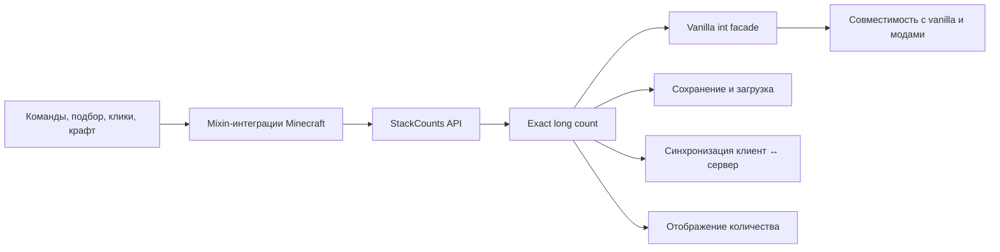

# Stack Unlimiter — карта репозитория

> [!abstract] Назначение
> Эта заметка — точка входа в кодовую базу. Открой корень репозитория как Obsidian vault и начинай работу отсюда.

> [!important] Главный инвариант
> `StackCounts.get(stack)` — источник истины. `ItemStack#getCount()` хранит только совместимый с Minecraft фасад и не должен использоваться для определения полного количества oversized-стака.

## Быстрая навигация

- [[README|Обзор проекта и поддерживаемые сборки]]
- [[CONTRIBUTING|Правила участия]]
- [[LICENSE.txt|MIT License]]
- [[.github/ISSUE_TEMPLATE/bug_report.yml|Шаблон баг-репорта]]
- [[forge-1.20.1/gradle.properties|Forge 1.20.1 — версии и метаданные]]
- [[forge-26.3/gradle.properties|Forge 26.3 — версии и метаданные]]
- [[fabric-26.3/gradle.properties|Fabric 26.3 — версии и метаданные]]

## Модули

Каждая пара Minecraft + mod loader — полностью самостоятельный Gradle-модуль. Сборку и тесты запускай из каталога нужной пары.

| Модуль | Minecraft | Loader | Java | Версия | Статус |
| --- | --- | --- | --- | --- | --- |
| [[forge-1.20.1/gradle.properties|forge-1.20.1]] | 1.20.1 | Forge | 17 | `gradle.properties` | активно тестируется |
| [[forge-26.3/gradle.properties|forge-26.3]] | 26.3 | Forge | 25 | `gradle.properties` | активно тестируется |
| [[fabric-26.3/gradle.properties|fabric-26.3]] | 26.3 | Fabric | 25+ для Gradle | `gradle.properties` | отдельная реализация |

> [!warning] Независимые реализации
> Исправление в одном модуле не переносится автоматически в остальные. Перед портированием сравни `stack_unlimiter.mixins.json`, Minecraft API и набор GameTest конкретной пары.

## Архитектура



### Модель количества

- [[forge-1.20.1/src/main/java/dev/asp1r/stackunlimiter/api/StackCounts.java|StackCounts]] — публичные операции `get`, `set`, `grow`, `shrink`, `split`, `copyWithCount` и проверка eligibility.
- [[forge-1.20.1/src/main/java/dev/asp1r/stackunlimiter/internal/LongCountMath.java|LongCountMath]] — безопасная арифметика, защита от отрицательных значений и переполнения.
- [[forge-1.20.1/src/main/java/dev/asp1r/stackunlimiter/internal/LongCountAccess.java|LongCountAccess]] — внутренний мост между API и `ItemStackMixin`.
- [[forge-1.20.1/src/main/java/dev/asp1r/stackunlimiter/mixin/ItemStackMixin.java|ItemStackMixin]] — перехватывает основные операции `ItemStack` и поддерживает фасадный `int count`.

Правила:

1. Exact-count — неотрицательный `long`.
2. Предметы с ванильным максимумом `1` остаются нестакаемыми.
3. Фасадный `count` равен `0` для пустого стака, иначе ограничивается ванильным максимумом предмета.
4. Сравнение стака для синхронизации должно учитывать exact-count.
5. Сравнение типа и компонентов для слияния не должно считать внутренний маркер exact-count частью идентичности предмета.

### Хранение и сеть

| Ветка | Exact-count в памяти | Сохранение | Сеть |
| --- | --- | --- | --- |
| Forge 1.20.1 | `@Unique long` в `ItemStackMixin` | [[forge-1.20.1/src/main/java/dev/asp1r/stackunlimiter/internal/LongCountNbt.java|LongCountNbt]] | [[forge-1.20.1/src/main/java/dev/asp1r/stackunlimiter/mixin/FriendlyByteBufMixin.java|FriendlyByteBufMixin]] добавляет временный exact-count в NBT пакета |
| Forge 26.3 | `DataComponents.CUSTOM_DATA` | внутренний ключ в custom data | сериализация компонентов Minecraft |
| Fabric 26.3 | `DataComponents.CUSTOM_DATA` | внутренний ключ в custom data | сериализация компонентов Minecraft |

## Карта подсистем

| Задача | Основные файлы | Что проверять |
| --- | --- | --- |
| Базовые операции стака | `api/StackCounts`, `internal/LongCountMath`, `mixin/ItemStackMixin` | точный остаток, split/copy, переполнение, non-stackable |
| Добавление в инвентарь и подбор | `mixin/InventoryMixin` | merge в заполненный фасадный стак, исходный остаток, свободный слот |
| Клики, переносы и drag | `mixin/AbstractContainerMenuInteractionMixin` или реализация меню конкретной ветки | ЛКМ, ПКМ, Shift, number key, double-click, drag, выброс |
| Ограничение слота | `mixin/SlotMixin` | допустимый максимум и принципиально нестакаемые предметы |
| `/give` | `mixin/GiveCommandMixin` | один exact-стак вместо множества по 64 |
| Крафт в инвентаре | `mixin/InventoryMenuMixin` | ингредиенты, результат, возврат остатков, bulk Shift-click |
| Recipe book | `mixin/StackedContentsMixin`, `mixin/ServerPlaceRecipeMixin`, `mixin/AbstractCraftingMenuAccessor` | расчёт количества рецептов и распределение всех ингредиентов |
| Forge item handlers | `mixin/ItemStackHandlerMixin` | insert/extract/simulate без потерь |
| Синхронизация меню | `ItemStack.matches`, сравнение remote slot, packet serialization | сервер изменился → клиент обязательно получил новый exact-count |
| Отрисовка | `client/StackCountDisplay`, `mixin/GuiGraphicsMixin`, иногда `AbstractContainerScreenMixin` | `65`, `999`, `1K`, крупные значения и ширина подписи |
| Интеграционные тесты | `gametest/StackCountGameTests` | полный игровой маршрут, не только изолированный метод |

## Forge 1.20.1

### Точки входа

- [[forge-1.20.1/src/main/java/dev/asp1r/stackunlimiter/StackUnlimiter.java|StackUnlimiter]] — Forge entry point.
- [[forge-1.20.1/src/main/resources/META-INF/mods.toml|mods.toml]] — loader, Minecraft range, версия и зависимости.
- [[forge-1.20.1/src/main/resources/stack_unlimiter.mixins.json|Mixin config]] — фактический список активных mixin.

### Особенности ветки

- Minecraft и Forge используют старую NBT-модель `ItemStack`.
- Сеть требует отдельного [[forge-1.20.1/src/main/java/dev/asp1r/stackunlimiter/mixin/FriendlyByteBufMixin.java|FriendlyByteBufMixin]].
- Клиентская синхронизация меню дополнительно проходит через Forge-сравнение `ItemStack.equals(stack, limitTags)`.
- [[forge-1.20.1/src/main/java/dev/asp1r/stackunlimiter/mixin/AbstractContainerMenuInteractionMixin.java|AbstractContainerMenuInteractionMixin]] содержит основную exact-логику кликов и remote-slot синхронизации.
- [[forge-1.20.1/src/main/java/dev/asp1r/stackunlimiter/mixin/GuiGraphicsMixin.java|GuiGraphicsMixin]] обязан явно рисовать exact-count и ниже `1000`, если фасад уже ограничен `64`.

### Тесты и сборка

```powershell
cd forge-1.20.1
.\gradlew.bat test
.\gradlew.bat runGameTestServer
.\gradlew.bat clean build
```

- Unit: [[forge-1.20.1/src/test/java/dev/asp1r/stackunlimiter/internal/LongCountMathTest.java|LongCountMathTest]], [[forge-1.20.1/src/test/java/dev/asp1r/stackunlimiter/client/StackCountDisplayTest.java|StackCountDisplayTest]].
- Integration: [[forge-1.20.1/src/main/java/dev/asp1r/stackunlimiter/gametest/StackCountGameTests.java|StackCountGameTests]].
- Результат: `forge-1.20.1/build/libs/`.

## Forge 26.3

### Точки входа

- [[forge-26.3/src/main/java/dev/asp1r/stackunlimiter/StackUnlimiter.java|StackUnlimiter]].
- [[forge-26.3/src/main/resources/META-INF/mods.toml|mods.toml]].
- [[forge-26.3/src/main/resources/stack_unlimiter.mixins.json|Mixin config]].

### Особенности ветки

- Exact-count хранится в `DataComponents.CUSTOM_DATA`.
- [[forge-26.3/src/main/java/dev/asp1r/stackunlimiter/api/StackCounts.java|StackCounts.sameItemSameComponents]] игнорирует только внутренний exact-count при сравнении custom data.
- [[forge-26.3/src/main/java/dev/asp1r/stackunlimiter/internal/BulkCraftingDispatch.java|BulkCraftingDispatch]] координирует bulk crafting.
- Forge-совместимость с capability-инвентарями находится в [[forge-26.3/src/main/java/dev/asp1r/stackunlimiter/mixin/ItemStackHandlerMixin.java|ItemStackHandlerMixin]].
- Описания GameTest лежат в `src/main/resources/data/stack_unlimiter/test_instance/`.

### Тесты и сборка

```powershell
cd forge-26.3
.\gradlew.bat test
.\gradlew.bat runGameTestServer
.\gradlew.bat clean build
```

- Unit: `src/test/java/dev/asp1r/stackunlimiter/`.
- Integration: [[forge-26.3/src/main/java/dev/asp1r/stackunlimiter/gametest/StackCountGameTests.java|StackCountGameTests]].
- Результат: `forge-26.3/build/libs/`.

## Fabric 26.3

### Точки входа

- [[fabric-26.3/src/main/java/dev/asp1r/stackunlimiter/StackUnlimiter.java|StackUnlimiter]].
- [[fabric-26.3/src/main/resources/fabric.mod.json|fabric.mod.json]].
- [[fabric-26.3/src/main/resources/stack_unlimiter.mixins.json|Mixin config]].

### Особенности ветки

- Модель exact-count близка к Forge 26.3, но loader-интеграции независимы.
- Здесь нет Forge `ItemStackHandlerMixin`.
- GameTest вынесены в отдельный source set `src/gametest`.
- Gradle-процесс должен запускаться на Java 25 или новее, а не только использовать toolchain.

### Тесты и сборка

```powershell
cd fabric-26.3
.\gradlew.bat test
.\gradlew.bat runGameTest
.\gradlew.bat clean build
```

- Unit: `src/test/java/dev/asp1r/stackunlimiter/`.
- Integration: [[fabric-26.3/src/gametest/java/dev/asp1r/stackunlimiter/gametest/StackCountGameTests.java|StackCountGameTests]].
- Результат: `fabric-26.3/build/libs/`.

## Диагностические маршруты

### Предмет подбирается, но цифра не меняется

1. Проверить exact-count серверного слота после `ItemEntity.playerTouch`.
2. Проверить, удалена ли `ItemEntity`.
3. Проверить, заметил ли `AbstractContainerMenu.broadcastChanges()` отличие remote slot.
4. Проверить packet round-trip одного слота.
5. Проверить, что клиент применил exact-count.
6. Проверить отрисовку: значения `65–999` не должны уходить в ванильный `getCount()`.

Начальные файлы: [[forge-1.20.1/src/main/java/dev/asp1r/stackunlimiter/mixin/InventoryMixin.java|InventoryMixin]], [[forge-1.20.1/src/main/java/dev/asp1r/stackunlimiter/mixin/AbstractContainerMenuInteractionMixin.java|AbstractContainerMenuInteractionMixin]], [[forge-1.20.1/src/main/java/dev/asp1r/stackunlimiter/mixin/FriendlyByteBufMixin.java|FriendlyByteBufMixin]], [[forge-1.20.1/src/main/java/dev/asp1r/stackunlimiter/mixin/GuiGraphicsMixin.java|GuiGraphicsMixin]].

### Переносится только 64 предмета

1. Найти первый вызов, где exact-count заменяется `getCount()`.
2. Разделить источник, переносимый стак и остаток; проверить каждый exact-count.
3. Проверить оба направления и пустой/совместимый целевой слот.
4. Для Forge отдельно проверить `ItemStackHandler` и режим simulation.

### Дюп или потеря предметов

Считать сумму exact-count до и после операции во всех участвующих местах: исходный слот, целевой слот, carried stack, crafting grid, item entity. Проверять не только итоговый слот, но и остаток источника.

### Ломается крафт или recipe book

Проверять по цепочке:

```text
StackedContents → ServerPlaceRecipe → crafting grid → result slot → bulk transfer → remaining items
```

### Неверная цифра или переполнение ячейки

Начинать с `StackCountDisplay` и `GuiGraphicsMixin`. Отдельные пороги: `64 → 65`, `999 → 1000`, суффиксы `K/M/B/T/Q/E`, максимальная ширина и `Long.MAX_VALUE`.

## Минимальная матрица регрессии

- exact-count: `65`, `999`, `1_000`, `100_000`, `1_000_000`, значение выше `Integer.MAX_VALUE`;
- ЛКМ/ПКМ по слоту и carried stack;
- Shift-click в обе стороны между игроком и контейнером;
- number key, double-click, primary/secondary drag;
- выброс одного предмета и всего стака;
- подбор одного предмета в стак `64` и подбор oversized item entity;
- `/give`;
- recipe book, обычный крафт и Shift-click результата;
- сохранение/загрузка мира;
- packet round-trip и реальная remote-slot синхронизация;
- Forge item handler: insert, extract, simulate;
- предмет с ванильным максимумом `1`.

## Рабочий цикл изменения

> [!todo] Definition of done
> 1. Ограничить работу одной запрошенной парой версия + loader.
> 2. Добавить регрессионный тест, который сначала воспроизводит ошибку.
> 3. Исправить причину, а не только визуальный симптом.
> 4. Запустить unit-тесты и GameTest нужного модуля.
> 5. Выполнить `clean build`.
> 6. Если менялся код или поведение мода — повысить версию модуля и обновить таблицу в [[README]]. Документация и публикационные файлы версию не повышают.
> 7. Проверить версию и Minecraft range внутри JAR.
> 8. Не добавлять `artwork/` в коммит без отдельного запроса.
> 9. Сделать содержательный commit и push.

## Когда обновлять эту карту

- добавлена новая пара Minecraft + loader;
- появился новый mixin или отдельный адаптер мода;
- изменился способ хранения или сетевой передачи exact-count;
- изменились команды сборки или тестов;
- диагностический маршрут оказался неполным.

Версии в таблице модулей — снимок состояния. Источник истины всегда находится в соответствующем `gradle.properties` и в [[README#Available builds|таблице сборок README]].
