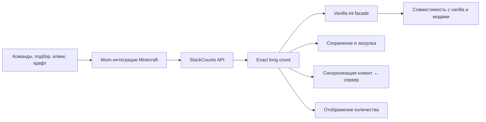

# Stack Unlimiter — карта репозитория

> [!abstract] Назначение
> Эта заметка — точка входа в кодовую базу. Открой корень репозитория как Obsidian vault и начинай работу отсюда.

> [!important] Главный инвариант
> `StackCounts.get(stack)` — источник истины. `ItemStack#getCount()` хранит только совместимый с Minecraft фасад и не должен использоваться для определения полного количества oversized-стака.

## Быстрая навигация

- [Обзор проекта и поддерживаемые сборки](README.md)
- [Правила участия](CONTRIBUTING.md)
- [Каталог релизных changelog и полей публикации](RELEASE_CHANGELOGS.md)
- [MIT License](LICENSE.txt)
- [Шаблон баг-репорта](.github/ISSUE_TEMPLATE/bug_report.yml)
- [Forge 1.20.1 — версии и метаданные](forge-1.20.1/gradle.properties)
- [Fabric 1.20.1 — версии и метаданные](fabric-1.20.1/gradle.properties)
- [Forge 1.21 — версии и метаданные](forge-1.21/gradle.properties)
- [Fabric 1.21 — версии и метаданные](fabric-1.21/gradle.properties)
- [NeoForge 1.21 — версии и метаданные](neoforge-1.21/gradle.properties)
- [Forge 26.3 — версии и метаданные](forge-26.3/gradle.properties)
- [Fabric 26.3 — версии и метаданные](fabric-26.3/gradle.properties)
- [NeoForge 26.3 — версии и метаданные](neoforge-26.3/gradle.properties)

## Модули

Каждая пара Minecraft + mod loader — полностью самостоятельный Gradle-модуль. Сборку и тесты запускай из каталога нужной пары.

| Модуль | Minecraft | Loader | Java | Версия | Changelog | Статус |
| --- | --- | --- | --- | --- | --- | --- |
| `forge-1.20.1` | 1.20.1 | Forge | 17 | `0.1.11` | Inventory fixes | загружен на Modrinth и CurseForge |
| `fabric-1.20.1` | 1.20.1 | Fabric | 17 | `0.1.12` | Initial Fabric release | загружен на Modrinth и CurseForge |
| `forge-1.21` | 1.21 | Forge | 21 | `0.1.15` | Inventory and shulker tooltip fixes | загружен на Modrinth и CurseForge |
| `fabric-1.21` | 1.21 | Fabric | 21 | `0.1.16` | Inventory and shulker tooltip fixes | загружен на Modrinth и CurseForge |
| `neoforge-1.21` | 1.21 | NeoForge | 21 | `0.1.18` | Shulker tooltip count fix | загружен на Modrinth и CurseForge |
| `forge-26.3` | 26.3 | Forge | 25 | `0.1.17` | Inventory and container tooltip fixes | собран; `0.1.16` загружен на Modrinth и CurseForge |
| `fabric-26.3` | 26.3 | Fabric | 25+ для Gradle | `0.1.10` | Inventory and container tooltip fixes | загружен на Modrinth и CurseForge |
| `neoforge-26.3` | 26.3 | NeoForge | 25 | `0.1.9` | Initial NeoForge release | загружен на Modrinth и CurseForge |

> [!warning] Независимые реализации
> Исправление в одном модуле не переносится автоматически в остальные. Перед портированием сравни `stack_unlimiter.mixins.json`, Minecraft API и набор GameTest конкретной пары.

## Архитектура



### Модель количества

- [StackCounts](forge-1.20.1/src/main/java/dev/asp1r/stackunlimiter/api/StackCounts.java) — публичные операции `get`, `set`, `grow`, `shrink`, `split`, `copyWithCount` и проверка eligibility.
- [LongCountMath](forge-1.20.1/src/main/java/dev/asp1r/stackunlimiter/internal/LongCountMath.java) — безопасная арифметика, защита от отрицательных значений и переполнения.
- [LongCountAccess](forge-1.20.1/src/main/java/dev/asp1r/stackunlimiter/internal/LongCountAccess.java) — внутренний мост между API и `ItemStackMixin`.
- [ItemStackMixin](forge-1.20.1/src/main/java/dev/asp1r/stackunlimiter/mixin/ItemStackMixin.java) — перехватывает основные операции `ItemStack` и поддерживает фасадный `int count`.

Правила:

1. Exact-count — неотрицательный `long`.
2. Предметы с ванильным максимумом `1` остаются нестакаемыми.
3. Фасадный `count` равен `0` для пустого стака, иначе ограничивается ванильным максимумом предмета.
4. Сравнение стака для синхронизации должно учитывать exact-count.
5. Сравнение типа и компонентов для слияния не должно считать внутренний маркер exact-count частью идентичности предмета.

### Хранение и сеть

| Ветка | Exact-count в памяти | Сохранение | Сеть |
| --- | --- | --- | --- |
| Forge 1.20.1 | `@Unique long` в `ItemStackMixin` | `LongCountNbt` | `FriendlyByteBufMixin` добавляет временный exact-count в NBT пакета |
| Fabric 1.20.1 | `@Unique long` в `ItemStackMixin` | `LongCountNbt` | `FriendlyByteBufMixin` добавляет временный exact-count в NBT пакета |
| Forge 1.21 | `DataComponents.CUSTOM_DATA` | внутренний ключ в custom data | сериализация компонентов Minecraft |
| Fabric 1.21 | `DataComponents.CUSTOM_DATA` | внутренний ключ в custom data | сериализация компонентов Minecraft |
| NeoForge 1.21 | `DataComponents.CUSTOM_DATA` | внутренний ключ в custom data | сериализация компонентов Minecraft |
| Forge 26.3 | `DataComponents.CUSTOM_DATA` | внутренний ключ в custom data | сериализация компонентов Minecraft |
| Fabric 26.3 | `DataComponents.CUSTOM_DATA` | внутренний ключ в custom data | сериализация компонентов Minecraft |
| NeoForge 26.3 | `DataComponents.CUSTOM_DATA` | внутренний ключ в custom data | сериализация компонентов Minecraft |

## Карта подсистем

| Задача | Основные файлы | Что проверять |
| --- | --- | --- |
| Базовые операции стака | `api/StackCounts`, `internal/LongCountMath`, `mixin/ItemStackMixin` | точный остаток, split/copy, переполнение, non-stackable |
| Добавление в инвентарь и подбор | `mixin/InventoryMixin` | merge в заполненный фасадный стак, исходный остаток, свободный слот |
| Клики, переносы и drag | `mixin/AbstractContainerMenuInteractionMixin` или реализация меню конкретной ветки | ЛКМ, ПКМ, Shift, number key, double-click, drag, выброс |
| Ограничение слота | `mixin/SlotMixin` | допустимый максимум и принципиально нестакаемые предметы |
| `/give` | `mixin/GiveCommandMixin` | один exact-стак вместо множества по 64 |
| Крафт в инвентаре | `mixin/InventoryMenuMixin` | ингредиенты, результат, возврат остатков, bulk Shift-click |
| Recipe book | `mixin/StackedContentsMixin`, `mixin/ServerPlaceRecipeMixin`, `mixin/AbstractCraftingMenuAccessor` | расчёт количества рецептов и распределение всех ингредиентов |
| Loader-specific storage API | Forge и NeoForge 1.21: `mixin/ItemStackHandlerMixin`; NeoForge 26.3: legacy API отсутствует | insert/extract/simulate без потерь там, где loader предоставляет отдельный handler API |
| Синхронизация меню | `ItemStack.matches`, сравнение remote slot, packet serialization | сервер изменился → клиент обязательно получил новый exact-count |
| Отрисовка | `client/StackCountDisplay`, `mixin/GuiGraphicsMixin`, иногда `AbstractContainerScreenMixin` | `65`, `999`, `1K`, крупные значения и ширина подписи |
| Интеграционные тесты | `gametest/StackCountGameTests` | полный игровой маршрут, не только изолированный метод |

## Forge 1.20.1

### Точки входа

- [StackUnlimiter](forge-1.20.1/src/main/java/dev/asp1r/stackunlimiter/StackUnlimiter.java) — Forge entry point.
- [mods.toml](forge-1.20.1/src/main/resources/META-INF/mods.toml) — loader, Minecraft range, версия и зависимости.
- [Mixin config](forge-1.20.1/src/main/resources/stack_unlimiter.mixins.json) — фактический список активных mixin.

### Особенности ветки

- Minecraft и Forge используют старую NBT-модель `ItemStack`.
- Сеть требует отдельного [FriendlyByteBufMixin](forge-1.20.1/src/main/java/dev/asp1r/stackunlimiter/mixin/FriendlyByteBufMixin.java).
- Клиентская синхронизация меню дополнительно проходит через Forge-сравнение `ItemStack.equals(stack, limitTags)`.
- [AbstractContainerMenuInteractionMixin](forge-1.20.1/src/main/java/dev/asp1r/stackunlimiter/mixin/AbstractContainerMenuInteractionMixin.java) содержит основную exact-логику кликов и remote-slot синхронизации.
- [GuiGraphicsMixin](forge-1.20.1/src/main/java/dev/asp1r/stackunlimiter/mixin/GuiGraphicsMixin.java) обязан явно рисовать exact-count и ниже `1000`, если фасад уже ограничен `64`.

### Тесты и сборка

```powershell
cd forge-1.20.1
.\gradlew.bat test
.\gradlew.bat runGameTestServer
.\gradlew.bat clean build
```

- Unit: [LongCountMathTest](forge-1.20.1/src/test/java/dev/asp1r/stackunlimiter/internal/LongCountMathTest.java), [StackCountDisplayTest](forge-1.20.1/src/test/java/dev/asp1r/stackunlimiter/client/StackCountDisplayTest.java).
- Integration: [StackCountGameTests](forge-1.20.1/src/main/java/dev/asp1r/stackunlimiter/gametest/StackCountGameTests.java).
- Результат: `forge-1.20.1/build/libs/`.

## Fabric 1.20.1

### Точки входа

- [StackUnlimiter](fabric-1.20.1/src/main/java/dev/asp1r/stackunlimiter/StackUnlimiter.java) — Fabric entry point.
- [fabric.mod.json](fabric-1.20.1/src/main/resources/fabric.mod.json) — точная версия Minecraft, минимальный Fabric Loader и Java 17.
- [Mixin config](fabric-1.20.1/src/main/resources/stack_unlimiter.mixins.json) — список серверных и клиентских интеграций.

### Особенности ветки

- Старая NBT-модель Minecraft 1.20.1 требует [LongCountNbt](fabric-1.20.1/src/main/java/dev/asp1r/stackunlimiter/internal/LongCountNbt.java) и [FriendlyByteBufMixin](fabric-1.20.1/src/main/java/dev/asp1r/stackunlimiter/mixin/FriendlyByteBufMixin.java).
- [AbstractContainerMenuInteractionMixin](fabric-1.20.1/src/main/java/dev/asp1r/stackunlimiter/mixin/AbstractContainerMenuInteractionMixin.java) покрывает ЛКМ, ПКМ, Shift-click, number key, double-click, drag и выброс exact-стаков.
- [InventoryMixin](fabric-1.20.1/src/main/java/dev/asp1r/stackunlimiter/mixin/InventoryMixin.java) объединяет подбор и вставку с существующим стаком, даже когда фасадный `count` уже равен `64`.
- Forge-specific `ItemStackHandler` и crafting events не переносятся. Vanilla-инвентари, сундуки и крафт покрываются независимой Fabric-реализацией.
- Fabric API `0.92.12+1.20.1` подключён только в среде разработки для GameTest. Итоговый JAR не содержит его и не объявляет runtime-зависимость; игроку нужен только Fabric Loader.
- Поддерживаемая матрица loader: Forge, Fabric и NeoForge. Quilt не рассматривается.

### Тесты и сборка

```powershell
cd fabric-1.20.1
.\gradlew.bat test
.\gradlew.bat runGametest
.\gradlew.bat clean build
```

- Unit: `src/test/java/dev/asp1r/stackunlimiter/`.
- Integration: [StackCountGameTests](fabric-1.20.1/src/gametest/java/dev/asp1r/stackunlimiter/gametest/StackCountGameTests.java).
- Подтверждённое состояние `0.1.12`: unit-тесты, `clean build` и все 22 теста `runGametest` проходят.
- JAR: `fabric-1.20.1/build/libs/stack_unlimiter-fabric-1.20.1-0.1.12.jar`.
- Metadata JAR: Minecraft строго `1.20.1`, Fabric Loader `>=0.20.1`, Java `>=17`; class-file version `61`.

### Публикация

- Modrinth и CurseForge: `0.1.12` загружен как Release с display name `Stack Unlimiter 0.1.12 — Fabric 1.20.1` и changelog из [каталога релизов](RELEASE_CHANGELOGS.md).

## Forge 1.21

### Точки входа

- [StackUnlimiter](forge-1.21/src/main/java/dev/asp1r/stackunlimiter/StackUnlimiter.java) — Forge entry point и регистрация тестов только для GameTest-среды.
- [mods.toml](forge-1.21/src/main/resources/META-INF/mods.toml) — Forge 51+, точный диапазон Minecraft `1.21` и Java 21.
- [Mixin config](forge-1.21/src/main/resources/stack_unlimiter.mixins.json) — серверные и клиентские интеграции ветки.

### Особенности ветки

- Exact-count хранится в `DataComponents.CUSTOM_DATA`; отдельный сетевой mixin не нужен, потому что компоненты `ItemStack` сериализуются Minecraft.
- [AbstractContainerMenuInteractionMixin](forge-1.21/src/main/java/dev/asp1r/stackunlimiter/mixin/AbstractContainerMenuInteractionMixin.java) покрывает ЛКМ, ПКМ, Shift-click, number key, double-click, drag и выброс exact-стаков.
- [InventoryMixin](forge-1.21/src/main/java/dev/asp1r/stackunlimiter/mixin/InventoryMixin.java) объединяет подбор и вставку с существующим oversized-стаком.
- [StackCounts.copyWithCount](forge-1.21/src/main/java/dev/asp1r/stackunlimiter/api/StackCounts.java) сохраняет тип предмета у нулевой копии, чтобы ванильный `Inventory.add` корректно выдавал принципиально нестакаемые инструменты и шалкеровые ящики.
- [ShulkerBoxBlockMixin](forge-1.21/src/main/java/dev/asp1r/stackunlimiter/mixin/ShulkerBoxBlockMixin.java) заменяет фасадное количество `64` в строках содержимого шалкера на сохранённый exact-count типа `long`.
- [ServerPlaceRecipeMixin](forge-1.21/src/main/java/dev/asp1r/stackunlimiter/mixin/ServerPlaceRecipeMixin.java) не позволяет recipe book подменять exact-count фасадным значением `64` при переносе ингредиентов.
- [InventoryMenuMixin](forge-1.21/src/main/java/dev/asp1r/stackunlimiter/mixin/InventoryMenuMixin.java) выполняет массовый Shift-крафт без цикла по сотням тысяч операций.
- Forge-совместимость с `ItemStackHandler` находится в [ItemStackHandlerMixin](forge-1.21/src/main/java/dev/asp1r/stackunlimiter/mixin/ItemStackHandlerMixin.java).
- Пустая тестовая структура находится в [empty.nbt](forge-1.21/src/main/resources/data/stack_unlimiter/structure/empty.nbt).

### Тесты и сборка

```powershell
cd forge-1.21
.\gradlew.bat test
.\gradlew.bat runGameTestServer
.\gradlew.bat clean build
```

- Unit: [LongCountMathTest](forge-1.21/src/test/java/dev/asp1r/stackunlimiter/internal/LongCountMathTest.java), [StackCountDisplayTest](forge-1.21/src/test/java/dev/asp1r/stackunlimiter/client/StackCountDisplayTest.java).
- Integration: [StackCountGameTests](forge-1.21/src/main/java/dev/asp1r/stackunlimiter/gametest/StackCountGameTests.java).
- Регрессионный тест проверяет `/give` для алмазной кирки и шалкерового ящика на сервере и после сетевой сериализации инвентаря.
- Регрессионный тест шалкера подтверждает, что exact-count `400000` сохраняется внутри компонента и отображается в tooltip без подмены на `64`.
- Подтверждённое состояние `0.1.15`: unit-тесты, `clean build` и все 25 обязательных тестов `runGameTestServer` проходят.
- JAR: `forge-1.21/build/libs/stack_unlimiter-forge-1.21-0.1.15.jar`.
- SHA-256: `D518950BC39E352DD93F794AF51B12CB890BF68FA95795605FD93DF90E9ED03B`.
- Metadata JAR: Minecraft строго `1.21`, Forge `>=51`, Java `>=21`; class-file version `65`.

### Публикация

- Modrinth и CurseForge: `0.1.13` загружен как Release с display name `Stack Unlimiter 0.1.13 — Forge 1.21`, Minecraft `1.21`, loader `Forge`, окружением Client + Server и changelog из [каталога релизов](RELEASE_CHANGELOGS.md).
- Неопубликованная сборка `0.1.14` заменена сборкой `0.1.15`.
- Modrinth и CurseForge: `0.1.15` загружен как Release с display name `Stack Unlimiter 0.1.15 — Forge 1.21`, Minecraft `1.21`, loader `Forge`, Java 21, окружением Client + Server и changelog из [каталога релизов](RELEASE_CHANGELOGS.md).

## Fabric 1.21

### Точки входа

- [StackUnlimiter](fabric-1.21/src/main/java/dev/asp1r/stackunlimiter/StackUnlimiter.java) — Fabric entry point.
- [fabric.mod.json](fabric-1.21/src/main/resources/fabric.mod.json) — точные зависимости Minecraft `1.21`, Fabric Loader `>=0.20.1` и Java `>=21`.
- [Mixin config](fabric-1.21/src/main/resources/stack_unlimiter.mixins.json) — серверные и клиентские интеграции ветки.

### Особенности ветки

- Exact-count хранится в `DataComponents.CUSTOM_DATA`; отдельный сетевой mixin не нужен, потому что компоненты `ItemStack` сериализуются Minecraft.
- [AbstractContainerMenuInteractionMixin](fabric-1.21/src/main/java/dev/asp1r/stackunlimiter/mixin/AbstractContainerMenuInteractionMixin.java) покрывает ЛКМ, ПКМ, Shift-click, number key, double-click, drag и выброс exact-стаков.
- [InventoryMixin](fabric-1.21/src/main/java/dev/asp1r/stackunlimiter/mixin/InventoryMixin.java) объединяет подбор и вставку с существующим oversized-стаком.
- [StackCounts.copyWithCount](fabric-1.21/src/main/java/dev/asp1r/stackunlimiter/api/StackCounts.java) сохраняет тип предмета у нулевой копии, чтобы ванильный `Inventory.add` не терял принципиально нестакаемые инструменты и шалкеровые ящики при `/give`.
- [ShulkerBoxBlockMixin](fabric-1.21/src/main/java/dev/asp1r/stackunlimiter/mixin/ShulkerBoxBlockMixin.java) заменяет фасадное количество `64` в строках содержимого шалкера на сохранённый exact-count типа `long`.
- [ServerPlaceRecipeMixin](fabric-1.21/src/main/java/dev/asp1r/stackunlimiter/mixin/ServerPlaceRecipeMixin.java) сохраняет exact-count при переносе ингредиентов через recipe book.
- [InventoryMenuMixin](fabric-1.21/src/main/java/dev/asp1r/stackunlimiter/mixin/InventoryMenuMixin.java) выполняет массовый Shift-крафт без цикла по сотням тысяч операций.
- Fabric API `0.102.0+1.21` используется только для GameTest. Итоговый JAR не содержит его и не объявляет runtime-зависимость; игроку нужен только Fabric Loader.
- `verifyRemappedMixinRefmap` проверяет релизный JAR и не позволяет собрать его без named-to-intermediary mappings для `ItemStackMixin` и `ShulkerBoxBlockMixin`.

### Тесты и сборка

```powershell
cd fabric-1.21
.\gradlew.bat test
.\gradlew.bat runGametest
.\gradlew.bat clean build
```

- Unit: [LongCountMathTest](fabric-1.21/src/test/java/dev/asp1r/stackunlimiter/internal/LongCountMathTest.java), [StackCountDisplayTest](fabric-1.21/src/test/java/dev/asp1r/stackunlimiter/client/StackCountDisplayTest.java).
- Integration: [StackCountGameTests](fabric-1.21/src/gametest/java/dev/asp1r/stackunlimiter/gametest/StackCountGameTests.java).
- Регрессионный тест проверяет `/give` для алмазной кирки и шалкерового ящика и подтверждает, что глобальный `ItemStack.EMPTY` не изменяется.
- Регрессионный тест шалкера подтверждает, что exact-count `400000` сохраняется внутри компонента и передаётся в tooltip без подмены на `64`.
- Подтверждённое состояние `0.1.16`: проверка remapped refmap, unit-тесты, `clean build` и все 24 обязательных теста `runGametest` проходят.
- JAR: `fabric-1.21/build/libs/stack_unlimiter-fabric-1.21-0.1.16.jar`.
- SHA-256: `10C5AEFB617DAC347ACEDC8AC3BC09C96543F3D33EB0CB3FC00A2947EB71516E`.
- Metadata JAR: Minecraft строго `1.21`, Fabric Loader `>=0.20.1`, Java `>=21`; class-file version `65`.

### Публикация

- Modrinth и CurseForge: `0.1.15` загружен как Release с display name `Stack Unlimiter 0.1.15 — Fabric 1.21`, Minecraft `1.21`, loader `Fabric`, окружением Client + Server и changelog из [каталога релизов](RELEASE_CHANGELOGS.md).
- Modrinth и CurseForge: `0.1.16` загружен как Release с display name `Stack Unlimiter 0.1.16 — Fabric 1.21`, Minecraft `1.21`, loader `Fabric`, Java 21, окружением Client + Server, без обязательной зависимости от Fabric API и с changelog из [каталога релизов](RELEASE_CHANGELOGS.md).

## NeoForge 1.21

### Точки входа

- [StackUnlimiter](neoforge-1.21/src/main/java/dev/asp1r/stackunlimiter/StackUnlimiter.java) — NeoForge entry point; `RegisterGameTestsEvent` регистрирует интеграционные тесты через mod event bus.
- [neoforge.mods.toml](neoforge-1.21/src/main/templates/META-INF/neoforge.mods.toml) — генерируемые metadata с точным диапазоном Minecraft `1.21`, NeoForge `>=21.0.167` и обязательной установкой с обеих сторон.
- [Mixin config](neoforge-1.21/src/main/resources/stack_unlimiter.mixins.json) — серверные и клиентские интеграции ветки; минимальная версия Mixin `0.8.6` соответствует NeoForge 21.0.

### Особенности ветки

- Exact-count хранится в `DataComponents.CUSTOM_DATA`; сохранение и сеть используют стандартную сериализацию компонентов Minecraft.
- [AbstractContainerMenuInteractionMixin](neoforge-1.21/src/main/java/dev/asp1r/stackunlimiter/mixin/AbstractContainerMenuInteractionMixin.java) покрывает ЛКМ, ПКМ, Shift-click, number key, double-click, drag и выброс exact-стаков.
- [InventoryMixin](neoforge-1.21/src/main/java/dev/asp1r/stackunlimiter/mixin/InventoryMixin.java) объединяет подбор и вставку с существующим oversized-стаком.
- [ServerPlaceRecipeMixin](neoforge-1.21/src/main/java/dev/asp1r/stackunlimiter/mixin/ServerPlaceRecipeMixin.java) сохраняет exact-count при переносе ингредиентов через recipe book.
- [InventoryMenuMixin](neoforge-1.21/src/main/java/dev/asp1r/stackunlimiter/mixin/InventoryMenuMixin.java) использует `CommonHooks` и `EventHooks` для совместимого массового Shift-крафта.
- NeoForge-совместимость с handler-инвентарями находится в [ItemStackHandlerMixin](neoforge-1.21/src/main/java/dev/asp1r/stackunlimiter/mixin/ItemStackHandlerMixin.java).
- [StackCounts.copyWithCount](neoforge-1.21/src/main/java/dev/asp1r/stackunlimiter/api/StackCounts.java) сохраняет тип предмета у нулевой копии, чтобы ванильный `Inventory.add` корректно выдавал принципиально нестакаемые инструменты и шалкеровые ящики.
- [ShulkerBoxBlockMixin](neoforge-1.21/src/main/java/dev/asp1r/stackunlimiter/mixin/ShulkerBoxBlockMixin.java) заменяет фасадное количество `64` в строках содержимого шалкера на сохранённый exact-count типа `long`.
- Все mixin используют Mojang-имена NeoForge напрямую (`remap = false`); refmap этой ветке не нужен.

### Тесты и сборка

```powershell
cd neoforge-1.21
.\gradlew.bat test
.\gradlew.bat runGameTestServer
.\gradlew.bat clean build
```

- Unit: [LongCountMathTest](neoforge-1.21/src/test/java/dev/asp1r/stackunlimiter/internal/LongCountMathTest.java), [StackCountDisplayTest](neoforge-1.21/src/test/java/dev/asp1r/stackunlimiter/client/StackCountDisplayTest.java).
- Integration: [StackCountGameTests](neoforge-1.21/src/main/java/dev/asp1r/stackunlimiter/gametest/StackCountGameTests.java).
- Подтверждённое состояние `0.1.18`: unit-тесты, `clean build` и все 25 обязательных тестов `runGameTestServer` проходят.
- Регрессионный тест проверяет `/give` для алмазной кирки и шалкерового ящика на сервере и после сетевой сериализации инвентаря.
- Регрессионный тест шалкера подтверждает, что exact-count `400000` сохраняется внутри компонента и отображается в tooltip без подмены на `64`.
- JAR: `neoforge-1.21/build/libs/stack_unlimiter-neoforge-1.21-0.1.18.jar`.
- Metadata JAR: Minecraft строго `1.21`, NeoForge `>=21.0.167`, Java 21; class-file version `65`.
- SHA-256: `BC61E8AD199F498E522DCFBCD6723198C1CDA7B4F61391E66BFF2B76961DF3BE`.

### Публикация

- Modrinth и CurseForge: `0.1.17` загружен как Release с display name `Stack Unlimiter 0.1.17 — NeoForge 1.21`, Minecraft `1.21`, loader `NeoForge`, Java 21, окружением Client + Server и changelog из [каталога релизов](RELEASE_CHANGELOGS.md).
- Modrinth и CurseForge: `0.1.18` загружен как Release с display name `Stack Unlimiter 0.1.18 — NeoForge 1.21`, Minecraft `1.21`, loader `NeoForge`, Java 21, окружением Client + Server и changelog из [каталога релизов](RELEASE_CHANGELOGS.md).

## Forge 26.3

### Точки входа

- [StackUnlimiter](forge-26.3/src/main/java/dev/asp1r/stackunlimiter/StackUnlimiter.java).
- [mods.toml](forge-26.3/src/main/resources/META-INF/mods.toml).
- [Mixin config](forge-26.3/src/main/resources/stack_unlimiter.mixins.json).

### Особенности ветки

- Exact-count хранится в `DataComponents.CUSTOM_DATA`.
- [StackCounts.sameItemSameComponents](forge-26.3/src/main/java/dev/asp1r/stackunlimiter/api/StackCounts.java) игнорирует только внутренний exact-count при сравнении custom data.
- [StackCounts.copyWithCount](forge-26.3/src/main/java/dev/asp1r/stackunlimiter/api/StackCounts.java) сохраняет тип предмета у нулевой копии, чтобы ванильный `Inventory.add` не терял принципиально нестакаемые инструменты и шалкеровые ящики при `/give` и не изменял общий `ItemStack.EMPTY`.
- [ItemContainerContentsMixin](forge-26.3/src/main/java/dev/asp1r/stackunlimiter/mixin/ItemContainerContentsMixin.java) сохраняет ванильную структуру tooltip контейнера, но передаёт exact-count типа `long` вместо фасадного значения `64`.
- [BulkCraftingDispatch](forge-26.3/src/main/java/dev/asp1r/stackunlimiter/internal/BulkCraftingDispatch.java) координирует bulk crafting.
- Forge-совместимость с capability-инвентарями находится в [ItemStackHandlerMixin](forge-26.3/src/main/java/dev/asp1r/stackunlimiter/mixin/ItemStackHandlerMixin.java).
- Описания GameTest лежат в `src/main/resources/data/stack_unlimiter/test_instance/`.

### Тесты и сборка

```powershell
cd forge-26.3
.\gradlew.bat test
.\gradlew.bat runGameTestServer
.\gradlew.bat clean build
```

- Unit: `src/test/java/dev/asp1r/stackunlimiter/`.
- Integration: [StackCountGameTests](forge-26.3/src/main/java/dev/asp1r/stackunlimiter/gametest/StackCountGameTests.java).
- Регрессионный тест проверяет `/give` для алмазной кирки и шалкерового ящика и подтверждает, что глобальный `ItemStack.EMPTY` не изменяется.
- Регрессионный тест контейнерного tooltip подтверждает, что exact-count `400000` сохраняется внутри шалкера и отображается без подмены на `64`.
- Подтверждённое состояние `0.1.17`: unit-тесты, `clean build` и все 39 обязательных тестов `runGameTestServer` проходят.
- JAR: `forge-26.3/build/libs/stack_unlimiter-forge-26.3-0.1.17.jar`.
- SHA-256: `6ED21DA632BA3D980423DF2CAA36318F04482962037A1233DA1C97EB4F91E867`.
- Metadata JAR: Minecraft строго `26.3`, Forge `>=66`, Java 25; class-file version `69`.

### Публикация

- Modrinth и CurseForge: `0.1.16` загружен как Release с display name `Stack Unlimiter 0.1.16 — Forge 26.3`.
- Исправление `0.1.17` собрано и проверено, но ещё не загружено на площадки; changelog подготовлен в [каталоге релизов](RELEASE_CHANGELOGS.md).

## Fabric 26.3

### Точки входа

- [StackUnlimiter](fabric-26.3/src/main/java/dev/asp1r/stackunlimiter/StackUnlimiter.java).
- [fabric.mod.json](fabric-26.3/src/main/resources/fabric.mod.json).
- [Mixin config](fabric-26.3/src/main/resources/stack_unlimiter.mixins.json).

### Особенности ветки

- Модель exact-count близка к Forge 26.3, но loader-интеграции независимы.
- Здесь нет Forge `ItemStackHandlerMixin`.
- [AbstractContainerMenuInteractionMixin](fabric-26.3/src/main/java/dev/asp1r/stackunlimiter/mixin/AbstractContainerMenuInteractionMixin.java) обрабатывает exact-count для ЛКМ, ПКМ, Shift-click, выброса, double-click, number key и drag.
- [InventoryMixin](fabric-26.3/src/main/java/dev/asp1r/stackunlimiter/mixin/InventoryMixin.java) отдельно перехватывает выброс всего выбранного хотбар-стака через `removeFromSelected`.
- [StackCounts.copyWithCount](fabric-26.3/src/main/java/dev/asp1r/stackunlimiter/api/StackCounts.java) сохраняет тип предмета у нулевой копии, чтобы ванильный `Inventory.add` не терял принципиально нестакаемые инструменты и шалкеровые ящики при `/give` и не изменял общий `ItemStack.EMPTY`.
- [ItemContainerContentsMixin](fabric-26.3/src/main/java/dev/asp1r/stackunlimiter/mixin/ItemContainerContentsMixin.java) сохраняет ванильную структуру tooltip контейнера, но передаёт exact-count типа `long` вместо фасадного значения `64`.
- [BulkCraftingDispatch](fabric-26.3/src/main/java/dev/asp1r/stackunlimiter/internal/BulkCraftingDispatch.java) оставляет массовый крафт авторитетным серверу и не позволяет клиентскому предсказанию повторно обработать результат.
- [AbstractContainerScreenMixin](fabric-26.3/src/main/java/dev/asp1r/stackunlimiter/mixin/AbstractContainerScreenMixin.java) использует exact-count при предпросмотре drag-распределения.
- Для текста количества нужен непрозрачный ARGB `0xFFFFFFFF`: `0xFFFFFF` имеет нулевой alpha и делает подпись невидимой в Minecraft 26.3.
- Fabric API используется только source set `src/gametest` для автоматических тестов. Production-код зависит от Fabric Loader и Mixin, поэтому Fabric API не является обязательной зависимостью для игрока и не добавляется в metadata релиза.
- `net.fabricmc.api.ModInitializer` входит в Fabric Loader, несмотря на имя пакета `fabricmc.api`.
- GameTest вынесены в отдельный source set `src/gametest`.
- Gradle-процесс должен запускаться на Java 25 или новее, а не только использовать toolchain.

### Тесты и сборка

```powershell
cd fabric-26.3
.\gradlew.bat test
.\gradlew.bat runGameTest
.\gradlew.bat clean build
```

- Unit: `src/test/java/dev/asp1r/stackunlimiter/`.
- Integration: [StackCountGameTests](fabric-26.3/src/gametest/java/dev/asp1r/stackunlimiter/gametest/StackCountGameTests.java).
- Регрессионный тест проверяет `/give` для алмазной кирки и шалкерового ящика и подтверждает, что глобальный `ItemStack.EMPTY` не изменяется.
- Регрессионный тест контейнерного tooltip подтверждает, что exact-count `400000` сохраняется внутри шалкера и отображается без подмены на `64`.
- Подтверждённое состояние `0.1.10`: unit-тесты, `clean build` и все 36 обязательных тестов `runGameTest` проходят.
- JAR: `fabric-26.3/build/libs/stack_unlimiter-fabric-26.3-0.1.10.jar`.
- SHA-256: `FDAC783E3A3A0F44F6270E62E18A6F977B354EF8CBAFB6E65759D4F59A60A21C`.
- Metadata JAR: Minecraft строго `26.3`, Fabric Loader `>=0.20.1`, Java `>=25`; class-file version `69`; Fabric API не объявлен runtime-зависимостью.

### Публикация

- Modrinth и CurseForge: `0.1.9` загружен как Release с display name `Stack Unlimiter 0.1.9 — Fabric 26.3`.
- Modrinth и CurseForge: `0.1.10` загружен как Release с display name `Stack Unlimiter 0.1.10 — Fabric 26.3`, Minecraft `26.3`, loader `Fabric`, Java 25, окружением Client + Server, без обязательной зависимости от Fabric API и с changelog из [каталога релизов](RELEASE_CHANGELOGS.md).

## NeoForge 26.3

### Точки входа

- [StackUnlimiter](neoforge-26.3/src/main/java/dev/asp1r/stackunlimiter/StackUnlimiter.java) — NeoForge entry point и регистрация GameTest-функций через mod event bus.
- [neoforge.mods.toml](neoforge-26.3/src/main/templates/META-INF/neoforge.mods.toml) — шаблон metadata; итоговый файл генерируется Gradle.
- [Mixin config](neoforge-26.3/src/main/resources/stack_unlimiter.mixins.json).

### Особенности ветки

- Exact-count хранится в `DataComponents.CUSTOM_DATA`; модель и полный набор vanilla-инвентарных операций перенесены из исправленной реализации 26.3.
- [AbstractContainerMenuInteractionMixin](neoforge-26.3/src/main/java/dev/asp1r/stackunlimiter/mixin/AbstractContainerMenuInteractionMixin.java) обрабатывает ЛКМ, ПКМ, Shift-click, number key, double-click, drag и выброс без обрезания до `64`.
- [AbstractContainerScreenMixin](neoforge-26.3/src/main/java/dev/asp1r/stackunlimiter/mixin/AbstractContainerScreenMixin.java) использует exact-count в клиентском предпросмотре drag-распределения.
- [BulkCraftingDispatch](neoforge-26.3/src/main/java/dev/asp1r/stackunlimiter/internal/BulkCraftingDispatch.java) координирует серверный массовый крафт.
- [InventoryMenuMixin](neoforge-26.3/src/main/java/dev/asp1r/stackunlimiter/mixin/InventoryMenuMixin.java) устанавливает crafting player через `CommonHooks` и отправляет NeoForge crafting event через `EventHooks`, сохраняя совместимость bulk crafting с событиями loader.
- В NeoForge 26.3 нет legacy Forge `ItemStackHandler`/`IItemHandler`, поэтому Forge-специфичный `ItemStackHandlerMixin` не переносится. Vanilla-инвентари и меню покрыты полностью.
- [GameTestRegistry](neoforge-26.3/src/main/java/dev/asp1r/stackunlimiter/gametest/GameTestRegistry.java) регистрирует 33 функции через `DeferredRegister` в `BuiltInRegistries.TEST_FUNCTION`.
- Data-driven описания находятся в `src/main/resources/data/stack_unlimiter/test_instance/`, а общая пустая структура — в [empty.nbt](neoforge-26.3/src/main/resources/data/stack_unlimiter/structure/empty.nbt).

### Тесты и сборка

Gradle запускается на Java 21, а Java 25 используется как toolchain компиляции. Это обходит несовместимость asset-задач NeoForge с запуском Gradle непосредственно на Java 25.

```powershell
cd neoforge-26.3
$env:JAVA_HOME='C:\Program Files\Microsoft\jdk-21.0.13.21-hotspot'
$env:Path="$env:JAVA_HOME\bin;$env:Path"
.\gradlew.bat test '-Dorg.gradle.java.installations.paths=C:\Program Files\Microsoft\jdk-21.0.13.21-hotspot,C:\Users\asp1r\.gradle\jdks\eclipse_adoptium-25-amd64-windows.2'
.\gradlew.bat runGameTestServer '-Dorg.gradle.java.installations.paths=C:\Program Files\Microsoft\jdk-21.0.13.21-hotspot,C:\Users\asp1r\.gradle\jdks\eclipse_adoptium-25-amd64-windows.2'
.\gradlew.bat clean build '-Dorg.gradle.java.installations.paths=C:\Program Files\Microsoft\jdk-21.0.13.21-hotspot,C:\Users\asp1r\.gradle\jdks\eclipse_adoptium-25-amd64-windows.2'
```

- Unit: `src/test/java/dev/asp1r/stackunlimiter/`.
- Integration: [StackCountGameTests](neoforge-26.3/src/main/java/dev/asp1r/stackunlimiter/gametest/StackCountGameTests.java).
- Подтверждённое состояние `0.1.9`: `test`, `clean build` и все 34 теста, обнаруженные `runGameTestServer`, проходят.
- Результат: `neoforge-26.3/build/libs/`.

### Публикация

- Modrinth и CurseForge: `0.1.9` загружен как Release с display name `Stack Unlimiter 0.1.9 — NeoForge 26.3` и одинаковым changelog из [NeoForge 26.3 — 0.1.9](RELEASE_CHANGELOGS.md).

## Диагностические маршруты

### `/give` сообщает об успехе, но нестакаемый предмет отсутствует

1. Проверить фактическое содержимое серверного `Inventory`, а не только сообщение команды.
2. Проверить `ItemStack.copyWithCount(0)`: ванильный `Inventory.add` использует нулевую типизированную копию как заготовку нового слота.
3. Нельзя возвращать глобальный `ItemStack.EMPTY`, иначе последующий `grow` изменит singleton пустого стака и предмет потеряется.
4. Регрессионный тест должен проверять инструмент и шалкеровый ящик как на сервере, так и после сетевой сериализации меню.

В NeoForge 1.21 ошибка исправлена в `0.1.17`, в Forge 1.21 — в `0.1.14`, в Fabric 1.21 — в `0.1.16`, в Fabric 26.3 — в `0.1.10`, а в Forge 26.3 — в `0.1.17`. Для каждой другой ветки нужен отдельный полный прогон её GameTest перед переносом исправления.

### Tooltip шалкерового ящика показывает `64` вместо exact-count

1. Проверить exact-count предмета внутри `DataComponents.CONTAINER`: если он сохранён, проблема относится только к отображению.
2. В Minecraft 1.21 `ShulkerBoxBlock.appendHoverText` напрямую вызывает фасадный `ItemStack.getCount()`.
3. В Minecraft 26.3 tooltip перенесён в `ItemContainerContents.addToTooltip` и использует ключ `item.container.item_count`; исправление 1.21 нельзя копировать без адаптации.
4. Исправлять нужно только числовой аргумент строки количества, не меняя глобальную семантику `getCount()` и остальные строки tooltip.
5. Регрессионный тест должен отдельно проверять сохранённое значение и сформированный аргумент перевода.

В Forge 1.21 отображение исправлено в `0.1.15`, в NeoForge 1.21 — в `0.1.18`, в Fabric 1.21 — в `0.1.16`, в Fabric 26.3 — в `0.1.10`, а в Forge 26.3 — в `0.1.17`.

### Fabric запускается в dev, но падает в обычном лаунчере

1. Найти первый `InvalidMixinException` в crash-report, а не последующие ошибки рендера.
2. Проверить refmap внутри remapped JAR и наличие записи для упавшего mixin.
3. Проверить `@Mixin(..., remap = false)`, `@Shadow` и имена целевых методов/полей.
4. Выполнить `verifyRemappedMixinRefmap`; dev GameTest использует named mappings и сам по себе не обнаруживает отсутствие production remapping.

Fabric 1.21 `0.1.14` падал при старте, потому что `ItemStackMixin` был исключён из remapping и поле `count` не преобразовывалось в intermediary-имя `field_8031`. Исправлено в `0.1.15`.

### Предмет подбирается, но цифра не меняется

1. Проверить exact-count серверного слота после `ItemEntity.playerTouch`.
2. Проверить, удалена ли `ItemEntity`.
3. Проверить, заметил ли `AbstractContainerMenu.broadcastChanges()` отличие remote slot.
4. Проверить packet round-trip одного слота.
5. Проверить, что клиент применил exact-count.
6. Проверить отрисовку: значения `65–999` не должны уходить в ванильный `getCount()`.

Начальные файлы: [InventoryMixin](forge-1.20.1/src/main/java/dev/asp1r/stackunlimiter/mixin/InventoryMixin.java), [AbstractContainerMenuInteractionMixin](forge-1.20.1/src/main/java/dev/asp1r/stackunlimiter/mixin/AbstractContainerMenuInteractionMixin.java), [FriendlyByteBufMixin](forge-1.20.1/src/main/java/dev/asp1r/stackunlimiter/mixin/FriendlyByteBufMixin.java), [GuiGraphicsMixin](forge-1.20.1/src/main/java/dev/asp1r/stackunlimiter/mixin/GuiGraphicsMixin.java).

### Переносится только 64 предмета

1. Найти первый вызов, где exact-count заменяется `getCount()`.
2. Разделить источник, переносимый стак и остаток; проверить каждый exact-count.
3. Проверить оба направления и пустой/совместимый целевой слот.
4. Для Forge отдельно проверить `ItemStackHandler` и режим simulation; в NeoForge 26.3 legacy handler API отсутствует.

### Дюп или потеря предметов

Считать сумму exact-count до и после операции во всех участвующих местах: исходный слот, целевой слот, carried stack, crafting grid, item entity. Проверять не только итоговый слот, но и остаток источника.

### Ломается крафт или recipe book

Проверять по цепочке:

```text
StackedContents → ServerPlaceRecipe → crafting grid → result slot → bulk transfer → remaining items
```

### Неверная цифра или переполнение ячейки

Начинать с `StackCountDisplay` и `GuiGraphicsMixin`. Отдельные пороги: `64 → 65`, `999 → 1000`, суффиксы `K/M/B/T/Q/E`, максимальная ширина и `Long.MAX_VALUE`.

Если подпись полностью отсутствует при правильном exact-count:

1. Проверить, что `StackCountDisplay.requiresExactLabel(exactCount, vanillaCount)` возвращает `true`.
2. Проверить загрузку `GuiGraphicsMixin` в секции `client` файла `stack_unlimiter.mixins.json`.
3. Проверить alpha-канал цвета. Для белого текста использовать `0xFFFFFFFF`, а не прозрачный `0x00FFFFFF`.
4. Проверить синхронизацию exact-count на клиенте до начала отрисовки.

## Минимальная матрица регрессии

- exact-count: `65`, `999`, `1_000`, `100_000`, `1_000_000`, значение выше `Integer.MAX_VALUE`;
- ЛКМ/ПКМ по слоту и carried stack;
- Shift-click в обе стороны между игроком и контейнером;
- number key, double-click, primary/secondary drag;
- выброс одного предмета и всего стака;
- подбор одного предмета в стак `64` и подбор oversized item entity;
- `/give`;
- recipe book, обычный крафт и Shift-click результата;
- сохранение/загрузка мира;
- packet round-trip и реальная remote-slot синхронизация;
- loader-specific storage handler: для Forge — insert, extract, simulate; для NeoForge 26.3 legacy Forge handler не применяется;
- предмет с ванильным максимумом `1`.

## Рабочий цикл изменения

> [!todo] Definition of done
> 1. Ограничить работу одной запрошенной парой версия + loader.
> 2. Добавить регрессионный тест, который сначала воспроизводит ошибку.
> 3. Исправить причину, а не только визуальный симптом.
> 4. Запустить unit-тесты и GameTest нужного модуля.
> 5. Выполнить `clean build`.
> 6. Если менялся код или поведение мода — повысить версию модуля и обновить таблицу в [README](README.md). Документация и публикационные файлы версию не повышают.
> 7. Проверить версию и Minecraft range внутри JAR.
> 8. Обновить эту карту, если изменились структура, версия, тестовая матрица, сборка, диагностика или важное техническое решение.
> 9. Не добавлять `artwork/` и `.obsidian/` в коммит без отдельного запроса.
> 10. Сделать содержательный commit и push.

### Рабочий цикл публикации

1. Сверить версию JAR и пару Minecraft + loader с таблицей модулей.
2. Взять точный текст из [RELEASE_CHANGELOGS](RELEASE_CHANGELOGS.md).
3. После подготовки нового текста сразу записать его в каталог с указанием площадки.
4. Не добавлять конкретную версию Minecraft в общее описание проекта.
5. Не повышать версию мода при изменении только публикационных документов.

## Когда обновлять эту карту

- добавлена новая пара Minecraft + loader;
- появился новый mixin или отдельный адаптер мода;
- изменился способ хранения или сетевой передачи exact-count;
- изменились команды сборки или тестов;
- диагностический маршрут оказался неполным.
- изменились версия модуля, покрытие операций или подтверждённое состояние тестов;
- обнаружена полезная причина бага или ограничение конкретной версии Minecraft/loader.
- подготовлен или изменён changelog релиза — обновить [RELEASE_CHANGELOGS](RELEASE_CHANGELOGS.md) и ссылку из таблицы модулей;

Версии в таблице модулей — снимок состояния. Источник истины всегда находится в соответствующем `gradle.properties` и в [таблице сборок README](README.md#available-builds).
